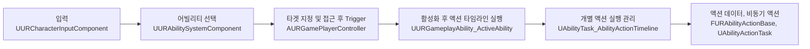

# 액티브 어빌리티 (액티브 스킬)

[`UURGameplayAbility_ActiveAbility`](https://github.com/expx2/UnrealRPGProject/blob/main/Source/URGame/AbilitySystem/GameplayAbility/URGameplayAbility_ActiveAbility.h)(액티브 스킬)는 사용자가 직접 사용하는 어빌리티로, 시스템은 `아이온2`를 참고했다.

BP에서 데이터를 조합하여 다양한 어빌리티를 만들어 낼 수 있는 데이터 기반 시스템으로 설계했다.

액티브 어빌리티는 LocalPredicted로 클라이언트 예측을 사용해 사용자 입력에 즉각적인 반응을 가진다. 

액티브 어빌리티는 플레이어 캐릭터와 적 캐릭터 모두 사용하지만, 해당 문서는 플레이어 캐릭터에서의 사용 관점에서 설명한다.

#### 사용 흐름

위 그림은 액티브 어빌리티의 대표적인 실행 흐름이다.

> [!NOTE]
>  초기엔 어빌리티 활성화 후 어빌리티 내부에서 실행 단계를 나눠 타겟 지정과 자동 이동을 진행했지만,
실제 스킬 사용 전에도 어빌리티가 활성화 된 상태라 활성화 태그 부여, 다른 어빌리티 활성화 차단 및 취소 등의 동작이 실행되고 이는 시스템의 의도와 맞지 않는 부분이 있어,
타겟 지정 및 접근과 실제 스킬의 사용을 담당하는 위치를 분리하는 방향으로 개선했다.

## 어빌리티 선택

시스템을 참고한 `아이온2`에서는 한 개의 스킬 슬롯에 여러개의 스킬을 등록하여 순서대로 사용할 수 있다.

이를 구현하기 위해 하나의 입력에 여러 어빌리티의 등록을 허용하며, 입력 시 해당 입력에 등록된 어빌리티를 전부 활성화 시도하지 않고
`UURAbilitySystemComponent::ResolveCurrentAbilityForInput`를 통해 하나의 어빌리티를 선택하여 활성화 시도한다.

실제 사용 가능 조건과 별도로 선택될 수 있는지 검사하는 함수 `UURGameplayAbility_ActiveAbility::DoesAbilitySatisfyTagRequirementsToSelect`를 구현해
현재 **조건을 만족하는 어빌리티 중 우선순위가 가장 높은 하나**를 선택한다.

> 조건을 만족하는 어빌리티가 없을 경우 Fallback으로 우선순위가 가장 높은 어빌리티를 선택한다.

> 이는 스킬 슬롯([`UURGameHUDAbilitySlotWidget`](https://github.com/expx2/UnrealRPGProject/blob/main/Source/URGame/UI/HUD/URGameHUDAbilitySlotWidget.h))에서 현재 표시할 스킬을 선택하는데에도 사용된다.

실제 사용 가능 조건과 별도의 조건을 가지는 이유는 실제 사용이 불가하더라도 스킬 슬롯에 표시하고, 활성화 시도 시 이유에 따른 메세지를 표시하기 위함이다. (추가로 참고한 시스템을 재현하기 위함이다.)

> 선택 예시)
우선순위가 A > B일 때,
A의 사용 마나는 부족하고
B의 사용 마나는 충분하더라도
선택되는 어빌리티는 A 어빌리티이다.

## 액티브 어빌리티의 활성화

액티브 어빌리티는 타겟팅 정책을 가지고 실행되며 정책에 따라 활성화 조건과 흐름이 변경된다.

해당 기능을 위해 액티브 어빌리티는 타겟(액터)을 가질 필요가 있어 **항상 타겟 정보를 담은 `FGameplayEventData`를 받아 트리거**된다.
(타겟이 없는 경우에도 `Target == nullptr`인 이벤트 데이터를 사용한다)

타겟 지정과 사용을 위한 자동 이동을 위해 `AbilitySystemComponent`에서 바로 활성화하지 않고, `AURGamePlayerController`를 거쳐 활성화한다.

### 액티브 어빌리티의 타겟팅 정책

| 정책                     | 설명                                           | 타겟이 있을 때                    | 타겟이 없을 때 |
|------------------------|----------------------------------------------|-----------------------------|----------|
| Targeting              | 타겟이 있어야 사용 가능                                | 타겟과 거리가 멀면 타겟에게 자동 이동 후 활성화 | 활성화 불가능  |
| NonTargetingWithTarget | 타겟이 없어도 사용 가능하지만, 타겟이 있을 경우 Targeting처럼 작동한다 | 타겟과 거리가 멀면 타겟에게 자동 이동 후 활성화 | 즉시 활성화   |
| NonTargeting           | 타겟이 없어도 사용 가능                                | 타겟 거리와 상관없이 즉시 활성화          | 즉시 활성화   |
| Range                  | 활성화 뒤 범위를 지정해 사용                             | 타겟 거리와 상관없이 즉시 활성화          | 즉시 활성화   |

`NonTargeting`, `Range` 정책의 경우 활성화 조건과 흐름에 타겟이 필요하지 않지만, 타격 대상 수 제한이 있는 어빌리티에서 타겟이 우선권을 가진다. [`Combat.md - 타격 대상 수 제한`](https://github.com/expx2/UnrealRPGProject/blob/main/Docs/Combat.md#타격-대상-수-제한과-우선순위)

### 타겟 선택 방법

게임 내의 여러 시스템에서 지정된 대상 액터들을 후보로 지정해 우선순위대로 액터의 피해 수신 가능 여부, 태그(상태), 진영 등을 검사한다.
검사를 통과하면 해당 액터를 타겟으로 지정하고 모든 후보가 유효하지 않으면 nullptr로 지정한다.

예외적으로 타겟팅 정책이 `Targeting`일 경우 첫 번 째 후보가 유효하지 않을 경우 후순위 후보 검사 없이 사용에 실패한다. (`아이온2` 참고함)

> 현재 구현에선 `UURTargetingComponent`의 `MainTarget`, `AimTarget`을 사용한다.

### 자동 이동

일부 정책에선 타겟과 거리가 멀 경우 사용 가능 거리까지 자동 이동을 수행하며 이는 `AURGamePlayerController`가 담당한다.

`UPathFollowingComponent`를 사용해 자동 이동을 시작하고, 대기 중인 어빌리티와 대상 정보를 저장한다.

자동 이동은 반응성을 위해 클라이언트에서 즉시 실행하며, 시작 시 서버 RPC를 통해 서버에서 1회 유효성 검사를 진행한다.

이동 도중엔 클라이언트에서 복제된 위치를 통해 유효성 검사와 거리를 검사하고 범위 내에 들어왔을 경우 저장해둔 대기 어빌리티를 트리거한다.

> 이동 중에 서버에선 유효성 검사를 하지 않는데, 이는 어빌리티 활성화 시 서버에서 유효성 검사가 이루어지기 때문에 생략했다.
> 유효하지 않은 대상을 향한 이동은 있더라도 유효하지 않은 대상을 향한 어빌리티 활성화는 되지 않는다.
> 서버에서 연산량을 줄이기 위함이고, 필요할 경우 시간 간격을 두고 검사하도록 해서 신뢰성과 최적화의 균형을 잡는게 필요할 듯.

#### 취소 상황 
- 유저의 이동 입력이 바뀌었을 때 (기존 이동 입력을 유지하거나, 이동을 멈추어도 자동 이동은 유지되지만 다른 방향으로 이동 시 중지된다)
- 다른 어빌리티 입력이 들어왔을 때
- 서버에서의 검증이 실패했을 때

### 활성화 이후

`FGameplayEventData` 유효성과 타겟팅 정책에 따른 타겟 정보 등 사용 가능 여부를 검증한다. 유효하지 않으면 종료한다.

`Range` 타겟팅 정책은 TargetActor를 생성하고 `UAbilityTask_WaitTargetData` 태스크를 사용해 별도의 타겟 데이터 설정 및 검증을 진행한다.

## 액션

액션은 어빌리티의 동작과 효과를 구성하는 데이터로 데이터 기반 액티브 어빌리티의 핵심이 되는 시스템이다.

모든 액션은 `FURAbilityActionBase`를 상속받으며 `TInstancedStruct` 배열로 BP에서 조합해 하나의 어빌리티를 구성한다.

이 시스템을 통해 확장성과 재사용성을 높이고 빠른 테스트 및 개발이 가능하도록 했다. 

### 액션 타임라인

어빌리티는 [`UAbilityTask_AbilityActionTimeline`](https://github.com/expx2/UnrealRPGProject/blob/main/Source/URGame/AbilitySystem/AbilityTask/AbilityTask_AbilityActionTimeline.h) 어빌리티 태스크를 실행한다.

`UAbilityTask_AbilityActionTimeline`은 액션을 설정된 시작 시간에 맞춰 병렬적으로 실행한다.

`FURAbilityActionBase`는 실행 결과를 반환하고 비동기 액션은 `UAbilityActionTask`를 함께 반환한다. 타임라인은 이 결과와 태스크를 통해 액션의 진행 상태를 관리한다.

액션 데이터와 별개로 실행 중 이동 제한 및 회전 제한 시간 Range를 가지고 이동과 회전을 제한한다. 종료 시점을 지정하지 않으면 타임라인 종료 시 해제한다.

모든 액션과 이동 및 회전 제한이 완료되면 타임라인이 종료된다.

### 주요 액션
| 액션                         | 설명                                                                 |
|----------------------------|--------------------------------------------------------------------|
| `MeleeTrace` | 사용자 위치에서 Trace를 진행해 GE를 부여한다. |
| `FindTargetAndTrace` | 사용자 기준 일정 범위 내에 대상을 찾고, 찾은 대상 위치에서 Trace를 진행해 GE를 부여한다.            
| `MoveTo` | 사용 캐릭터를 지정한 위치로 이동시킨다.                                             |
| `PlayMontageAndWait` | AnimMontage를 실행한다.                                                 |

> 모든 액션은 클라이언트와 서버에서 모두 실행되지만, 대상 검출과 GE 부여 같은 핵심 동작은 Authority있는 서버에서만 수행하도록 제한한다.

### 액션 실패 정책

각 액션을 실패 시 처리 정책 `EAbilityActionFailedPolicy`를 가진다.

액션 타임라인을 즉시 종료하여 중지하거나, 유지하는 방식으로 중요도에 따라 처리한다.

## 네트워크 지연과 프레임 지연 보정

`UURGameplayAbility_ActiveAbility`는 LocalPredicted 정책을 사용한다. 

반응성을 위해 클라이언트는 서버의 응답을 기다리지 않고 액션 타임라인을 시작하며, **실행 시점의 서버 시간을 전송**한다.

서버는 클라이언트가 보낸 시작 시간을 받아 액션 타임라인의 경과 시간을 보정해 시작한다.

> [!IMPORTANT]
> 이는 클라이언트에 맞춰 서버를 보정하는 방법으로 신뢰성은 비교적 떨어질 수 있지만 플레이 감각을 위하여 이 방식을 택했다.
> 다만 **클라이언트가 보낸 시간을 그대로 신뢰하지 않고 평균 RTT와 비교하거나 최대 지연 시간을 제한하는 작업을 거쳐 보정 시간을 구하는 식으로 보완**한다.

타임라인은 각 액션의 시작 시간에 맞춰 액션을 실행하지만, 네트워크 지연과 프레임 지연 등으로 액션의 실행 시간이 늦어질 수 있다. 액션 실행 시 경과 시간을 각 액션에 전달하고, 각 액션은 원래 의도된 시작 시간과 비교해 고유의 방식으로 보정한다.

### 보정 예시
| 액션                         | 설명                                                         |
|----------------------------|------------------------------------------------------------|
| `MeleeTrace` | 밀린 타격 회차를 한 프레임에 처리한다                                      |
| `PlayMontageAndWait` | 정책에 따라 AnimMontage의 실행 속도를 조절하거나, 시작 시간을 설정해 중간 부분부터 실행한다. |

<i>Pktlag=200 에서의 보정 테스트</i>

### 한계와 개선 방안

| 한계 | 개선 |
|--|--|
| 클라이언트에서 서버로 보낸 시간을 통해 서버는 보정되어 올바른 시점에 히트 처리를 하지만 클라이언트에 피드백을 보내는데 지연이 생겨 클라이언트 입장에선 공격 모션과 히트 시점이 틀릴 수 있다. | 히트 피드백 또한 로컬 예측을 사용하도록 고도화할 수 있겠으나 서버에서 히트하지 못 했을 경우 생기는 부정적인 감각을 감수해야 하고 보완할 추가적인 처리가 필요하다. [참고 영상](https://youtu.be/HSRo7TAV4T4?t=843) |
| 다단히트를 사용할 경우 네트워크 지연과 프레임 지연으로 한 프레임에 여러 회차 타격이 들어갈 수 있는데, 이는 의도치 않은 강한/약한 공격이 될 수 있다.                    | 공격 시점의 서버 상태를 재구성(리와인드)해서 검사하는 식으로 개선 가능하나 많은 작업이 필요할 것으로 예상.                                                                            
| 어빌리티 활성화 후 짧은 시간 내에 시작되고 종료되는 액션은 보정의 효과를 받지 못 한다.                                                        | 기획적으로 선행 시간 확보   |
