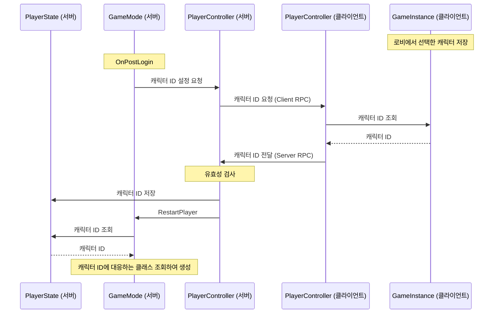
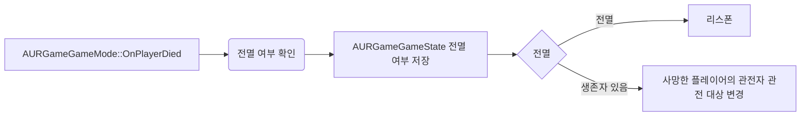

# 게임 플레이 아키텍처

게임 플레이에서 객체별 책임, 데이터 흐름, 시스템 간 연결을 설명한다

## 플레이어 캐릭터 선택과 생성

로비에서 선택한 캐릭터 ID는 레벨 이동 후에도 유지할 수 있도록 클라이언트의 `UURGameInstance`에 저장한다.

`AURGameGameMode`는 `AGameModeBase::OnPostLogin`를 오버라이드 해 플레이어 로그인 후
`AURGamePlayerController`에 캐릭터 ID를 요청한다.

`AURGamePlayerController`는 클라이언트 RPC로 캐릭터 코드를 요청하고,
수신하면 `UURGameInstance`에 저장된 캐릭터 ID를 서버 RPC로 서버에 전달한다.

서버에서는 검증 후 `AURGamePlayerState`에 저장하고 `AGameModeBase::RestartPlayer`를 호출해 캐릭터를 생성한다. 

#### 스크립트 
- [`AURGameGameMode`](https://github.com/expx2/UnrealRPGProject/blob/main/Source/URGame/GameModes/URGameGameMode.h): 캐릭터 ID 요청
- [`AURGamePlayerController`](https://github.com/expx2/UnrealRPGProject/blob/main/Source/URGame/Player/URGamePlayerController.h): 캐릭터 ID 송수신 및 검증
- [`AURGamePlayerState`](https://github.com/expx2/UnrealRPGProject/blob/main/Source/URGame/Player/URGamePlayerState.h): 서버에서 캐릭터 ID 저장
- [`UURGameInstance`](https://github.com/expx2/UnrealRPGProject/blob/main/Source/URGame/GameInstances/URGameInstance.h): 클라이언트에서 선택한 캐릭터 ID 저장

## 캐릭터와 GAS의 소유 관계

플레이어는 `AbilitySystemComponent`(이하 ASC)을 `PlayerState`에서 소유한다.

적 캐릭터는 캐릭터가 ASC를 소유하여 캐릭터와 같은 수명을 가진다.

이를 통해 플레이어는 캐릭터가 사망하여 파괴되어도 사망 상태를 유지하고
캐릭터가 리스폰되어도 쿨다운 등의 상태를 유지할 수 있다.

| 구분                | 플레이어                 | 적                   |
|-------------------|----------------------|---------------------|
| 클래스               | `AURPlayerCharacter` | `AUREnemyCharacter` |
| ASC 소유            | `PlayerState`        | `Character`         |
| ASC `OwnerActor`  | `PlayerState`        | `Character`         |
| ASC `AvatarActor` | `Character`          | `Character`         |
| `AttributeSet` 소유 | `PlayerState`        | `Character`         |

> 이 구조로 인해 발생하는 공격자 문제  
> GE(타격) 적용 시 Context는 공격 주체인 `Instigator`와 실제 효과를 발생시킨 객체인 `EffectCauser`를 제공한다.
> 공격자 캐릭터가 직접 공격하지 않고, 투사체같이 생성된 액터를 통해 공격할 경우 `EffectCauser`는 투사체가 된다.
> 따라서 두 값 중 하나를 그대로 사용하면 실제 공격자 캐릭터가 아닌 `PlayerState` 혹은 투사체를 공격자로 인식할 수 있다.  
> =>`UURAggroComponent`에선 Instigator가 ASC를 가지고 있을 경우 AvatarActor인 실제 공격 캐릭터를 구해 처리한다.

#### 스크립트
- [`AURGamePlayerState`](https://github.com/expx2/UnrealRPGProject/blob/main/Source/URGame/Player/URGamePlayerState.h): 플레이어의 ASC 및 `AttributeSet` 소유
- [`AURASCCharacter`](https://github.com/expx2/UnrealRPGProject/blob/main/Source/URGame/Character/URASCCharacter.h): 플레이어와 적 캐릭터의 공통 부모로 ASC를 가진 캐릭터 베이스
- [`AURPlayerCharacter`](https://github.com/expx2/UnrealRPGProject/blob/main/Source/URGame/Character/URPlayerCharacter.h): `PlayerState`의 ASC 연결
- [`AUREnemyCharacter`](https://github.com/expx2/UnrealRPGProject/blob/main/Source/URGame/Character/UREnemyCharacter.h): 적 캐릭터의 `AttributeSet` 소유

## 플레이어 입력

입력은 Lyra 프로젝트를 참고해 작성했다.

[`UURCharacterInputComponent`](https://github.com/expx2/UnrealRPGProject/blob/main/Source/URGame/Character/URCharacterInputComponent.h)를 독립된 컴포넌트로 두어, 캐릭터 클래스와 역할을 분리한다. `EnhancedInputComponent`에 입력을 바인딩하고 그에 따른 행동 구현을 담당한다.

#### 어빌리티 바인딩 흐름
1. `EAbilityInputBinds`로 어빌리티 실행 입력을 정의한다.
2. `UURCharacterInputComponent`에서 `UURInputMappingSet`을 통해 `InputAction`에 따른 `EAbilityInputBinds`를 바인딩 한다.
3. `UURGameplayAbilitySet`에서 `AbilitySystemComponent`에 어빌리티를 등록할 때 `GameplayAbilitySpec`의 `InputID`에 `EAbilityInputBinds`를 연결한다.

#### 스크립트
- [`UURCharacterInputComponent`](https://github.com/expx2/UnrealRPGProject/blob/main/Source/URGame/Character/URCharacterInputComponent.h): `UURInputComponent`를 받아 입력을 바인딩하고 그에 따른 행동 구현을 담당한다.
- [`UURInputComponent`](https://github.com/expx2/UnrealRPGProject/blob/main/Source/URGame/Input/URInputComponent.h): `UEnhancedInputComponent` 상속 받아 Bind 함수를 제공한다.
- [`UURInputMappingSet`](https://github.com/expx2/UnrealRPGProject/blob/main/Source/URGame/Input/URInputMappingSet.h): `InputAction`에 따른 `EAbilityInputBinds`를 관리한다.
- [`UURGameplayAbilitySet`](https://github.com/expx2/UnrealRPGProject/blob/main/Source/URGame/AbilitySystem/GameplayAbility/URGameplayAbilitySet.h): 어빌리티와 `EAbilityInputBinds`을 묶어 관리하고, `AbilitySystemComponent`에 어빌리티를 등록한다.

## 플레이어 사망과 관전 및 리스폰

`AURASCCharacter`는 `UHealthComponent`의 사망 이벤트를 구독해 어빌리티 취소, 사망 GE 적용 등 공통 사망 처리를 진행한다.

`AURPlayerCharacter`는 추가로 로컬 연출과 사망 UI를 열고, 서버에서는 `GameMode`에 플레이어의 사망을 알린다.

`AURGameGameMode`는 전멸 여부를 판정하고, `AURGameGameState`에 전멸 판정 결과 값을 저장하고 클라이언트에 복제한다.

전멸 시 플레이어 전체 리스폰을 진행하고 생존한 플레이어가 있을 경우 관전을 할 수 있도록 대기한다.

> 사망한 플레이어를 관전 중이던 관전자들은 관전 대상을 변경한다. (생존한 플레이어가 있을 경우)

사망 UI에서 관전을 선택하면 서버에서 사망 및 전멸 상태를 검사한 뒤 관전 상태로 전환하여 생존한 플레이어를 관전한다.

#### 향후 개선 과제
- 연결이 끊긴 캐릭터는 제거하지 않고 재연결 시 사용 (캐릭터 뿐만 아니라 `PlayerState`가 관리하는 ASC를 유지해야 한다.)
- 입장 중인 플레이어를 포함한 전멸 판정 고도화 혹은 난입한 플레이어 대기 

#### 스크립트
- [`UURHealthComponent`](https://github.com/expx2/UnrealRPGProject/blob/main/Source/URGame/Character/URHealthComponent.h): `UURHealthSet` 연결하여 사망 이벤트 발행
- [`AURASCCharacter`](https://github.com/expx2/UnrealRPGProject/blob/main/Source/URGame/Character/URASCCharacter.h): 공통 사망 처리
- [`AURPlayerCharacter`](https://github.com/expx2/UnrealRPGProject/blob/main/Source/URGame/Character/URPlayerCharacter.h): 로컬 연출과 UI 표시, `AURGameMode::OnPlayerDied` 호출
- [`AURGameGameMode`](https://github.com/expx2/UnrealRPGProject/blob/main/Source/URGame/GameModes/URGameGameMode.h): 플레이어 전멸 판정, 리스폰 관리 및 실행
- [`AURGameGameState`](https://github.com/expx2/UnrealRPGProject/blob/main/Source/URGame/GameStates/URGameGameState.h): 전멸 여부 값 저장 및 값 변경 이벤트 발행
